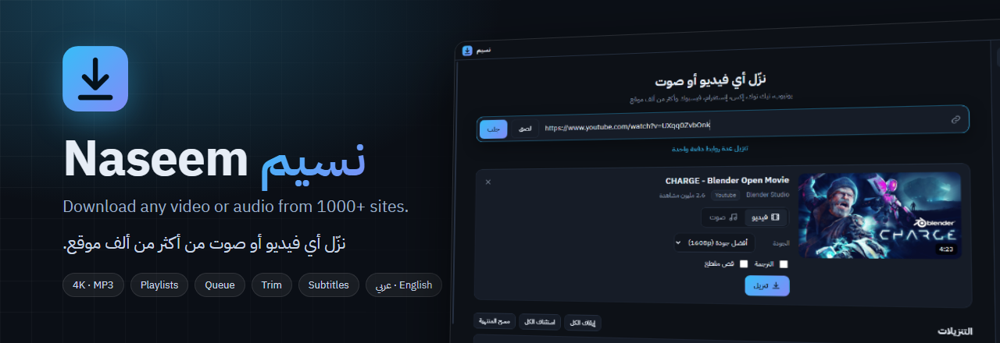
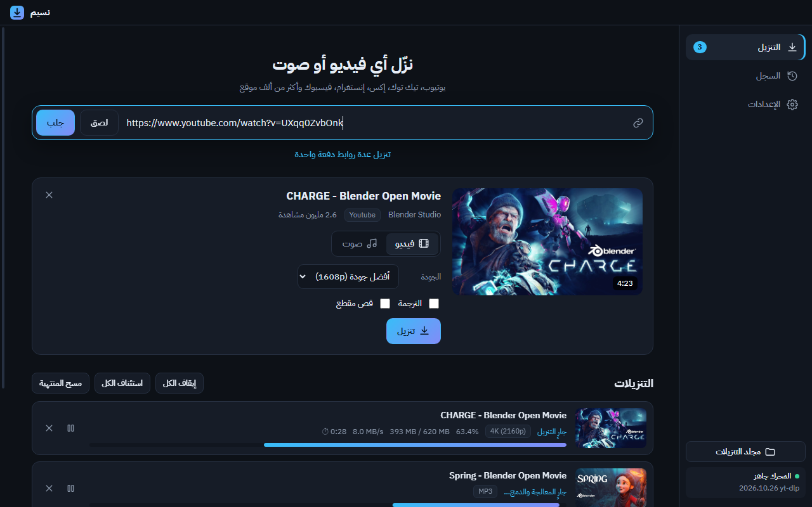
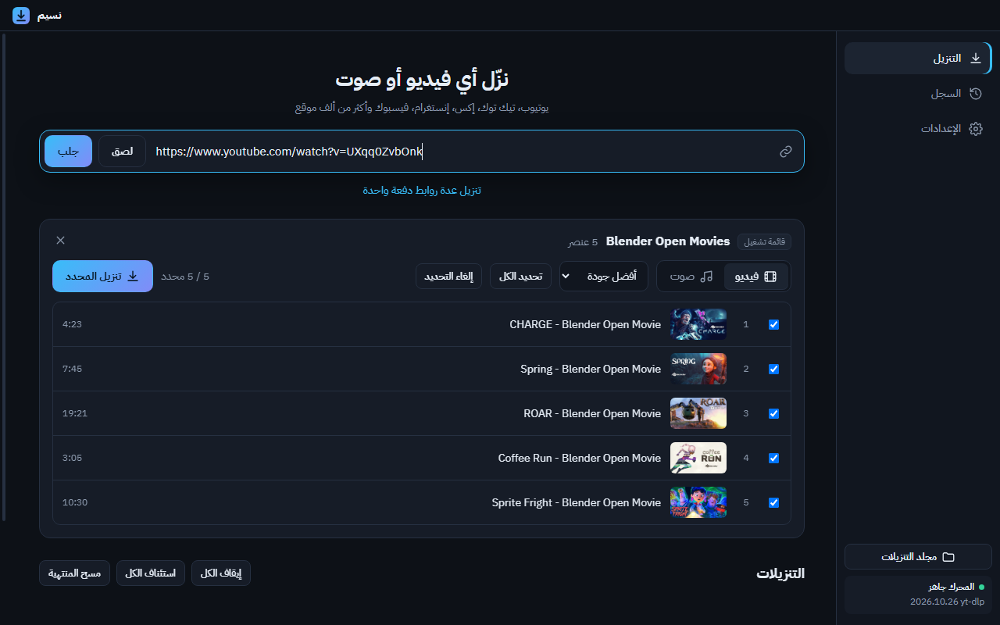
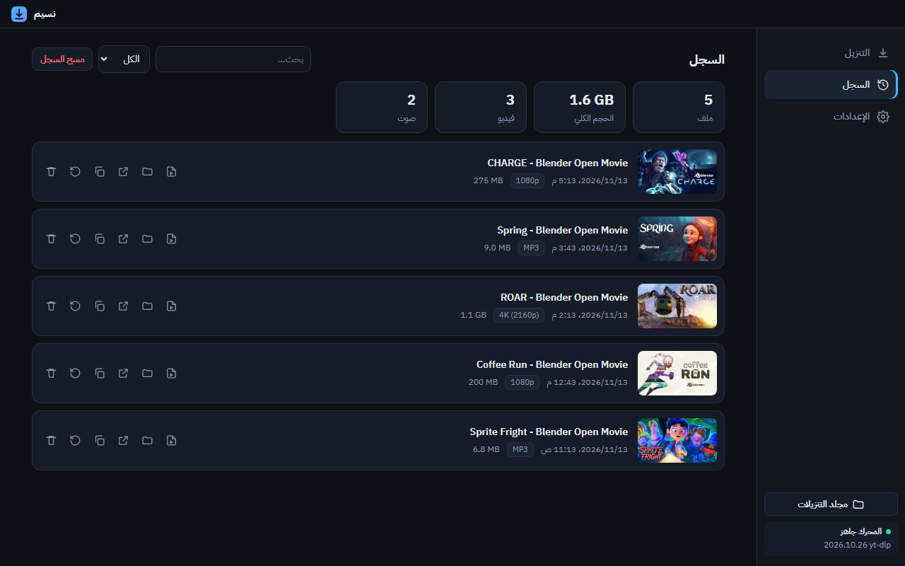
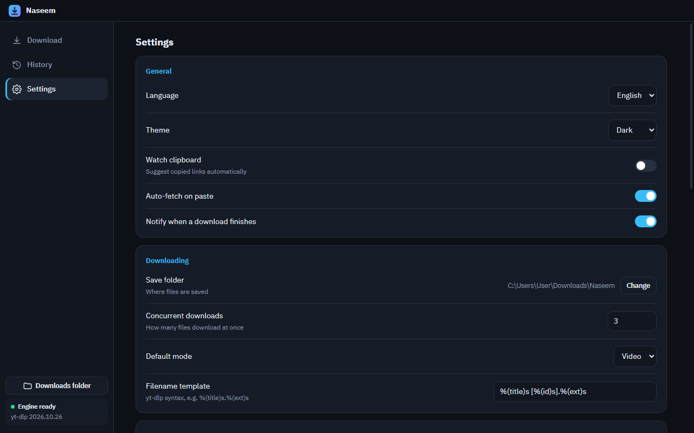
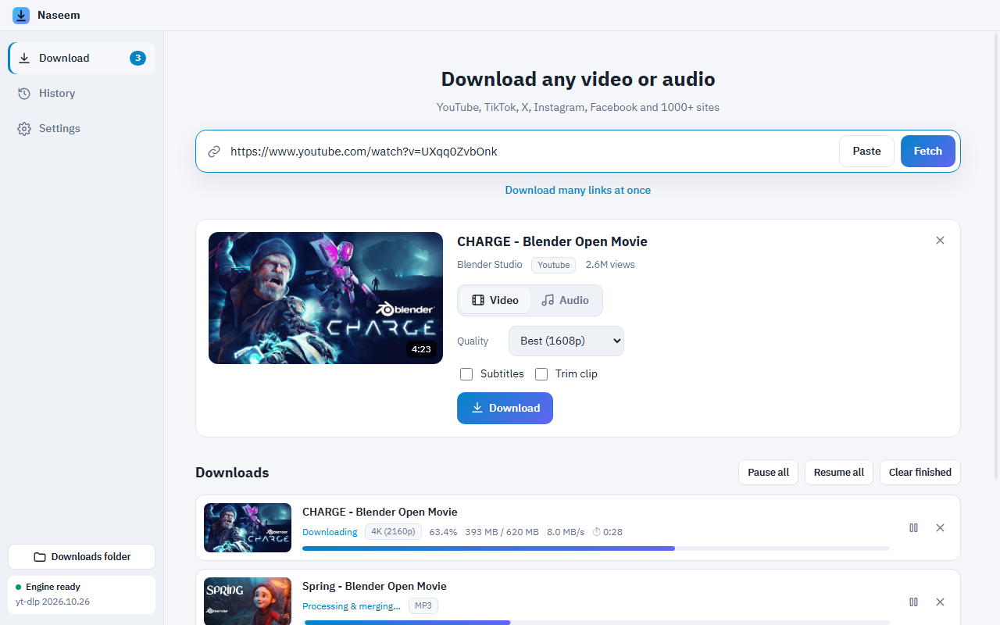

<p align="center">
  
</p>

<p align="center">
  <a href="https://github.com/c4fal/naseem/releases/latest"></a>
</p>

<p align="center">
  
  
  
  
  
</p>

<p align="center">
  <b>English</b> · <a href="#العربية">العربية</a>
</p>

---

<picture>
  <source media="(prefers-color-scheme: light)" srcset="docs/home-light.png">
  
</picture>

## ✨ Features

| | |
|---|---|
| 🎬 **Any quality** | Pick 4K, 1080p, 720p… with an estimated file size for each option |
| 🎵 **Audio only** | Save as MP3, M4A, OPUS, FLAC or WAV, with cover art and metadata embedded |
| 📋 **Smart queue** | Parallel downloads with live speed and ETA; pause, resume, cancel or retry any item |
| 📚 **Playlists** | See every video in a playlist and tick only the ones you want |
| 🔗 **Batch mode** | Paste many links at once, one per line |
| ✂️ **Trim** | Download only part of a video, e.g. `1:00 → 2:30` |
| 💬 **Subtitles** | Embed subtitles in your languages (manual or auto-generated) |
| 📎 **Clipboard watch** | Copy a link anywhere and Naseem offers to download it; drag & drop and <kbd>Ctrl</kbd>+<kbd>V</kbd> work too |
| 🕘 **History** | Searchable history with stats, one-click re-download, open file or folder |
| ⏭️ **SponsorBlock** | Optionally remove sponsor and self-promo segments from YouTube videos |
| 🍪 **Accounts & network** | Use cookies from Chrome, Edge, Firefox, Brave…; proxy and speed limit |
| 🌗 **Made for you** | Arabic (RTL) and English, dark, light or system theme, desktop notifications |
| 🔄 **Self-updating engine** | Install and update yt-dlp + FFmpeg from inside the app |

## 📸 Screenshots

<table>
  <tr>
    <td width="50%"><p align="center"><sub>Playlist selection</sub></p></td>
    <td width="50%"><p align="center"><sub>Download history</sub></p></td>
  </tr>
  <tr>
    <td width="50%"><p align="center"><sub>Settings</sub></p></td>
    <td width="50%"><p align="center"><sub>Light theme · English</sub></p></td>
  </tr>
</table>

## 🚀 Get started

1. Download **`Naseem-Setup-1.0.0.exe`** (installer) or **`Naseem-Portable-1.0.0.exe`** (no install) from [**Releases**](https://github.com/c4fal/naseem/releases/latest).
2. Open Naseem and press **Install engine**. It fetches yt-dlp and FFmpeg once (~100 MB).
3. Paste a link and press **Fetch**, choose a quality, then **Download**.

> [!TIP]
> If a site suddenly stops working, go to **Settings → Engine → Update engine**. Sites change often and yt-dlp updates quickly.

## 🛠️ Build from source

Requires [Node.js](https://nodejs.org) 20 or newer.

```bash
npm install
npm start
```

Build the installer and portable exe:

```bash
npm run dist
```

> [!NOTE]
> NSIS fails on very long folder paths. If the build errors with `could not open file`, copy the project to a short path such as `C:\naseem` and build there.

<details>
<summary><b>Project structure</b></summary>

```
main.js          Main process: yt-dlp runner, download queue, history, settings, engine installer
preload.js       Safe bridge between the window and the main process
renderer/
  index.html     App layout
  styles.css     Dark / light themes, RTL support
  app.js         UI logic and Arabic / English translations
build/icon.png   App icon
docs/            README images
```

</details>

---

<div dir="rtl" align="right">

## العربية

**نسيم** برنامج مجاني لويندوز لتنزيل الفيديو والصوت من يوتيوب وتيك توك وإكس وإنستغرام وفيسبوك وأكثر من ألف موقع، بواجهة عربية كاملة.

### المميزات

- اختيار الجودة حتى 4K مع الحجم التقريبي لكل خيار
- تنزيل الصوت فقط بصيغة MP3 أو M4A أو OPUS أو FLAC أو WAV مع صورة الغلاف
- قائمة تنزيلات متزامنة مع السرعة والوقت المتبقي، وإيقاف مؤقت واستئناف وإلغاء
- قوائم التشغيل مع اختيار الفيديوهات المطلوبة فقط
- تنزيل عدة روابط دفعة واحدة
- قص مقطع محدد من الفيديو
- تضمين الترجمة بلغاتك المفضلة
- مراقبة الحافظة، وسحب الرابط وإفلاته، و<kbd>Ctrl</kbd>+<kbd>V</kbd> من أي مكان
- سجل تنزيلات مع البحث والإحصائيات
- حذف الإعلانات المدمجة (SponsorBlock)، وكوكيز المتصفح، وبروكسي، وحد للسرعة
- مظهر داكن وفاتح، وإشعارات عند الانتهاء
- تحديث المحرك بضغطة زر

### طريقة الاستخدام

1. نزّل ملف **`Naseem-Setup-1.0.0.exe`** أو النسخة المحمولة **`Naseem-Portable-1.0.0.exe`** من صفحة [**الإصدارات**](https://github.com/c4fal/naseem/releases/latest).
2. افتح البرنامج واضغط **«تثبيت المحرك»** (مرة واحدة فقط).
3. الصق الرابط، واختر الجودة، ثم اضغط **«تنزيل»**.

</div>

---

## ⚖️ License notes

yt-dlp ([Unlicense](https://github.com/yt-dlp/yt-dlp/blob/master/LICENSE)) and FFmpeg ([LGPL/GPL](https://ffmpeg.org/legal.html)) are downloaded at runtime and keep their own licenses. The interface font is [IBM Plex Sans Arabic](https://github.com/IBM/plex) (SIL OFL 1.1). Sample thumbnails in the screenshots are from Blender Studio open movies (CC BY).

Only download content you have the right to download.
